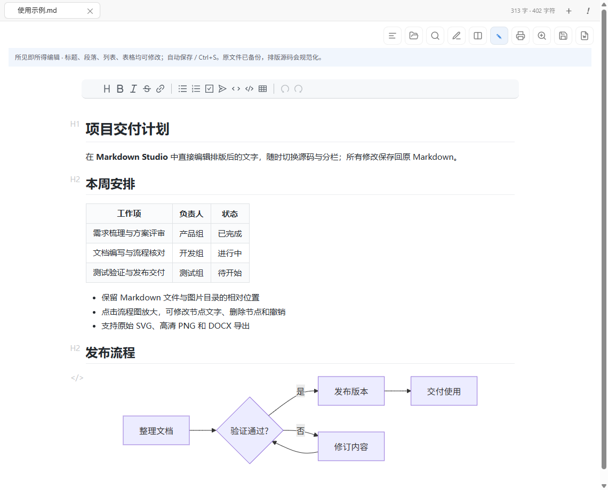
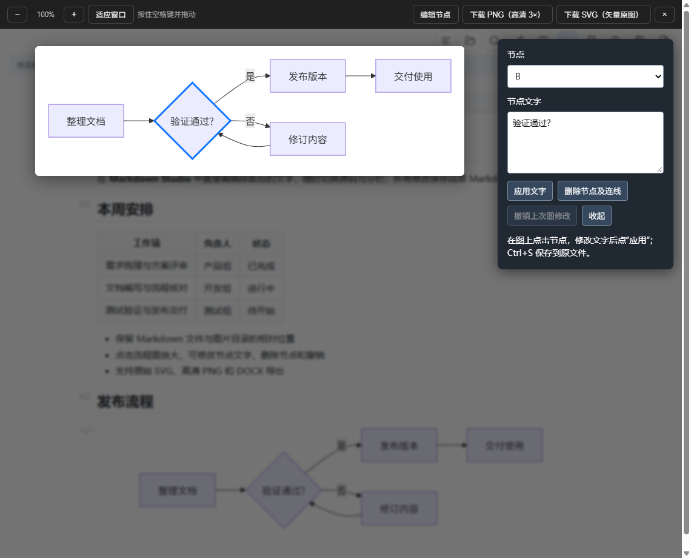

# Markdown Studio

**[English](README_en.md) · 简体中文**

[](https://github.com/galen2027/md-studio/releases/latest)
[](https://github.com/galen2027/md-studio/releases)
[](LICENSE)

本地 Markdown **编辑、预览、流程图修改和文档导出**工具。既可以直接修改排版后的文字，也可以使用源码或左右分栏编辑。

基于 Rust 与系统 WebView，渲染和编辑资源离线内嵌。当前正式交付 **Windows x64 便携版**。

## 下载 Windows 版

**[下载可直接运行的 EXE](https://github.com/galen2027/md-studio/releases/latest/download/MD-Preview-windows-x64.exe)** · [完整便携包 ZIP](https://github.com/galen2027/md-studio/releases/download/v1.9.10/MD-Studio-v1.9.10-windows-x64.zip) · [版本更新](CHANGELOG.md)

| 文件 | 用途 |
| --- | --- |
| `MD-Preview-windows-x64.exe` | 主程序，直接运行，无需安装应用本身 |
| `MD-Preview-windows-x64.exe.sha256` | 主程序完整性校验 |
| `MD-Studio-v1.9.10-windows-x64.zip` | 主程序、说明和许可证，便于完整分发 |
| `MD-Studio-Deployment-v1.9.10-zh.md` | 安装、验证、备份恢复和回滚说明 |

EXE 保留原文件名以兼容已有打开方式和更新流程，程序显示名称为 **Markdown Studio**。下载文件见本仓库 [Releases](https://github.com/galen2027/md-studio/releases)，Git 源码中不存储编译后的 EXE/ZIP。

**运行环境：**建议 Windows 11 x64，必须具有 Microsoft Edge WebView2 Runtime。通常系统已自带；缺失时程序会提示，[微软下载入口](https://developer.microsoft.com/microsoft-edge/webview2/)。无需另装 VC++ Runtime、Node、Python、Rust、Mermaid 或 Vditor。

发布程序暂未进行 Authenticode 签名，Windows 可能提示未知发布者。请核对来源和 SHA-256，无需关闭系统安全保护。

```powershell
Get-FileHash .\MD-Preview-windows-x64.exe -Algorithm SHA256
.\MD-Preview-windows-x64.exe --version
```

## 能做什么

| 能力 | 当前行为 |
| --- | --- |
| 格式化内容直接编辑 | 标题、含粗体/链接/行内代码的段落、列表、引用、表头及表格单元格可修改 |
| 源码与分栏 | 左侧预览、右侧源码独立滚动，按源码位置同步，跟随光标及查找替换定位 |
| Mermaid 图形修改 | 放大窗口中点选 `flowchart` / `graph` 节点，修改文字、删除节点及关联连线、撤销图修改 |
| 图形阅读与下载 | 矢量缩放、适配窗口、空格加左键平移，下载 SVG 原图及 3 倍 PNG |
| 查找替换 | Ctrl+F 搜索；Ctrl+H 对 Markdown 源码进行单项或全部替换 |
| 标签与保存 | 多文档标签、会话恢复、新建未命名文档、另存为、自动保存及 Ctrl+S |
| 本地图片与链接 | 图片按 MD 所在目录解析，本地文档链接打开或激活标签 |
| DOCX 导出 | 生成 Word 文档，支持可选模板、列宽计算、表格实线、重复表头及格式标准化 |
| PDF / 打印 | 从当前内容生成预览后打印；直接导出 PDF 需要 Edge 或 Chrome |
| 阅读辅助 | 目录导航、字符统计、正文缩放、代码高亮、KaTeX 公式及 Markdown 表格 |

生成 DOCX 不需要 Word；打开生成的文件需要 Word、WPS 或 LibreOffice。



## 开始使用

1. 退出旧版窗口，把 EXE 放到固定本机目录，再启动。单实例机制会复用仍在运行的旧程序，因此升级时要先退出旧版。
2. 打开或拖入 `.md` / `.txt` 文件；再次从资源管理器打开文档，会在当前程序新增或激活标签。
3. 在工具栏选择“所见即所得编辑”，直接点击格式化内容输入；选择源码或分栏按钮可切换编辑方式。
4. 停顿约一秒自动保存，Ctrl+S 立即保存回原文件。只读或权限失败时可另存为、放弃关闭或取消。
5. 要修改流程图：**点击图放大 → 编辑节点 → 点击节点 → 应用文字**。删除需再次确认，也可撤销当前图编辑会话中的修改。



| 快捷键 | 操作 |
| --- | --- |
| Ctrl+F / Ctrl+H | 查找 / 源码替换 |
| Ctrl+S / Ctrl+Shift+S | 保存 / 另存为 |
| Ctrl+N | 新建未命名文档 |
| Ctrl+Z / Ctrl+Y | 编辑模式内撤销 / 重做 |
| 空格 + 鼠标左键拖动 | 在已放大的 Mermaid 图中平移 |
| Esc | 关闭图形窗口或退出相应编辑界面；组合输入期间保留输入法处理 |

## 保存、备份与限制

- **自动保存直接写回原文件。**进入格式化文字编辑、应用流程图修改前，会备份磁盘原文件到配置目录 `backups/`；失败时不应用操作。
- 默认配置目录为 `%LOCALAPPDATA%\md-preview`，沿用旧版位置，避免升级后丢失会话。`MD_PREVIEW_CONFIG_DIR` 可指定其他位置；未保存的新文档没有磁盘原文备份。
- 富文本编辑会重新序列化 Markdown，空白、列表符号和表格排版等可能规范化。撤销历史不跨模式或标签保留；长期回退请使用备份或版本控制。
- Mermaid 图形编辑目前只支持 `flowchart` / `graph` 的**节点**；暂不提供节点拖拽、连线文字编辑或其他图类型的图形编辑。无法安全定位的扩展语法、使用数字索引 `linkStyle` 的节点删除会提示改用源码。
- 分栏按块位置同步，超长单段、自定义 HTML 等内容只能近似对应，不能保证逐像素对齐。
- 跨电脑迁移时一起复制 MD 和图片目录并保留相对结构；文档中写死的绝对盘符路径仍要求目标文件存在。
- 真实外部文件冲突会暂停自动保存并保留编辑。先决定保留哪个版本，再显式保存或另存，不要直接丢弃未保存内容。

[完整部署和回滚说明](<docs/MD Studio 发布部署方案_v1.9.10_261119.md>) · [隐私说明](docs/privacy.html) · [问题反馈](https://github.com/galen2027/md-studio/issues)

## 平台与验证范围

Windows x64 是本仓库当前正式发布和本机 WebView2 验证的平台。源码保留 macOS、Linux、iOS 和 Android 实现；CI 编译成功不等于原生使用验收，本版本没有发布这些平台的安装包，也不代表维护上游 App Store 应用。

已覆盖文字/表格编辑、图片连续保存、文件冲突、分栏同步、图节点编辑/删除/撤销、SVG/PNG 下载和 DOCX XML 回归。物理中文输入法、干净 Windows 11 VM、Word/WPS/LibreOffice 的本版本人工渲染仍有待验证项，详见部署说明和 [测试索引](tests/README.md)。

## 从源码构建

```bash
git clone https://github.com/galen2027/md-studio.git
cd md-studio
cargo build --locked
cargo test --locked
cargo build --release --locked
```

Cargo 包和本地构建文件名保持 `md-preview`，Windows 输出在 `target/release/md-preview.exe`。浏览器测试使用开发机已有 Node 与 Playwright；接收发布 EXE 的电脑不需要它们。

```bash
bash scripts/verify.sh
# Windows 原生工作流，先 cargo build
node scripts/verify-preview-workflows.mjs
node scripts/verify-structured-edit.mjs
```

发布包由 `scripts/package-windows-release.ps1` 生成；手动 Windows 构建工作流只生成草稿，正式发布需核对资产和校验值。[维护者发布说明](release/README.md) · [模块设计](docs/预览编辑模块设计_v1.2_261119.md)

## 开源来源与许可证

本项目基于 [vorojar/md-preview](https://github.com/vorojar/md-preview) 继续开发，保留原作者版权和 [MIT 许可证](LICENSE)。本仓库主要增加了文档导出、Windows 便携性、格式化文字编辑、分栏同步与流程图节点编辑等能力。

Vditor、Lute、KaTeX 等组件的许可证各自适用，详见 [第三方声明](assets/editor/THIRD-PARTY-NOTICES.md) 和相应许可正文。项目更新、下载和反馈入口指向本仓库。
