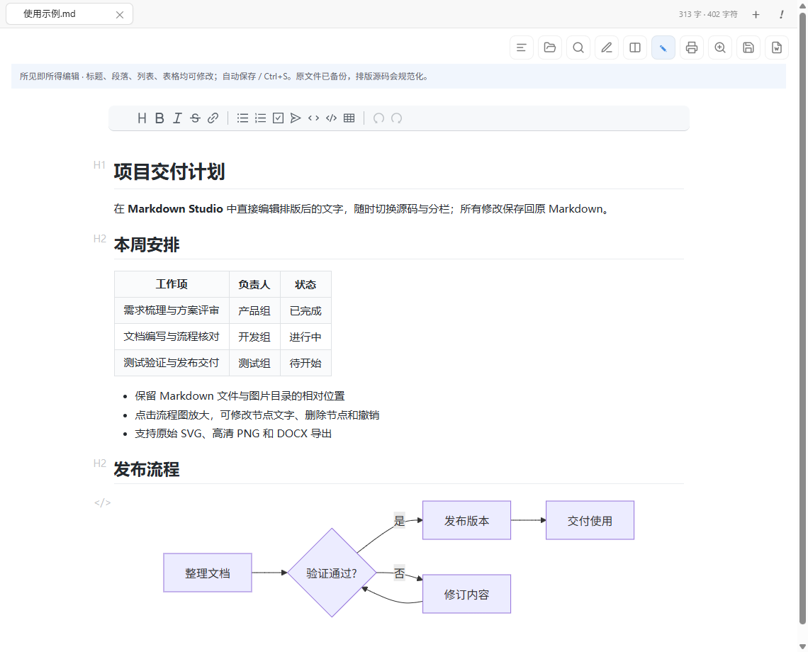
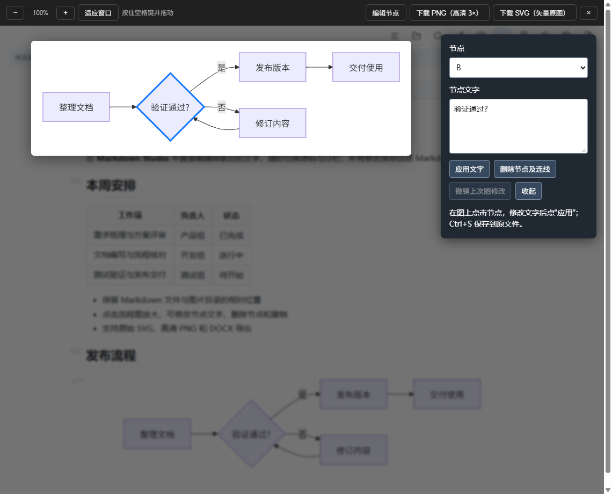

# Markdown Studio

**English · [简体中文](README.md)**

A local Markdown editor, previewer and document export tool, built with Rust and the system WebView. Edit formatted text, work with synchronized source/preview panes, and change Mermaid flowchart nodes directly.

## Windows download

**[Download the directly runnable Windows x64 EXE](https://github.com/galen2027/md-studio/releases/latest/download/MD-Preview-windows-x64.exe)** · [Complete portable ZIP](https://github.com/galen2027/md-studio/releases/download/v1.9.10/MD-Studio-v1.9.10-windows-x64.zip) · [Release notes](CHANGELOG.md)

The executable retains its compatibility filename, `MD-Preview-windows-x64.exe`; the application identifies itself as Markdown Studio. Exit previous versions before upgrading, then run the EXE from a stable local directory. The single-instance mechanism can otherwise forward the new invocation to an older running process.

Windows x64 requires Microsoft Edge WebView2 Runtime. No separate VC++ Runtime, Node, Python, Rust or editor libraries are required. The EXE is currently unsigned; verify its accompanying SHA-256 before running it. Do not disable Windows protection.

## Features

- WYSIWYG editing of headings, rich paragraphs, lists, quotes and table cells, including bold text, links and inline code.
- Independent source and preview panes synchronized by source positions; caret movement and find/replace reveal the corresponding preview content.
- Flowchart node selection, text changes, deletion of nodes and incident edges, and diagram undo in the Mermaid lightbox.
- Vector zoom, Space + left-button drag, original SVG and 3x PNG downloads.
- Multi-document tabs, session restore, untitled documents, Save As, autosave and Ctrl+S.
- Ctrl+F search and Ctrl+H source replacement, with single/all replacement.
- Document-relative local images and local Markdown links, offline highlighting, KaTeX and Mermaid rendering.
- DOCX export with optional template learning, stable table widths, solid borders and repeated headers. Word is not required to generate DOCX.
- Printing and direct PDF export; the latter requires an installed Edge or Chrome browser.



To edit a diagram: **click the rendered graph → Edit nodes → click a node → Apply text**. Deletion requires confirmation. Text editing, source editing and split view remain available.



## Saving and boundaries

Autosave writes to the original file. Before entering rich editing or applying a diagram change, the disk original is backed up in the configuration directory's `backups/`. The default directory remains `%LOCALAPPDATA%\md-preview` for compatibility; `MD_PREVIEW_CONFIG_DIR` can override it. Unsaved documents do not yet have disk originals.

Rich editing may normalize Markdown whitespace, lists and table layout. Undo history does not persist across mode/tab changes. Genuine external conflicts pause autosave and preserve local edits; read-only failures retain Save As / discard / cancel recovery.

Visual diagram editing currently covers **flowchart/graph nodes**. Node dragging, edge-label editing and other diagram types require source editing. Unsupported extensions and deletion with indexed `linkStyle` rules are rejected rather than changing unrelated content. Long blocks and custom HTML only have approximate split alignment.

Copy Markdown together with its relative image directories. Absolute drive paths remain machine-dependent. Render/editor assets are embedded, but remote images or links in your own document may access the network. The app checks this repository's GitHub Releases after first paint; it does not upload Markdown as part of update checking.

## Platform status

The published, locally verified package is **Windows x64**. Other platform implementations remain in the source tree. Compile checks do not establish native runtime acceptance, and this fork does not publish or claim ownership of upstream mobile-store apps.

Real Chinese IME input, clean Windows VM coverage and fresh Word/WPS/LibreOffice visual acceptance still have outstanding manual checks. See the [deployment guide](<docs/MD Studio 发布部署方案_v1.9.10_261119.md>) and [test index](tests/README.md).

## Development

```bash
git clone https://github.com/galen2027/md-studio.git
cd md-studio
cargo build --locked
cargo test --locked
cargo build --release --locked
bash scripts/verify.sh
```

The compatibility Cargo binary remains `md-preview`, with Windows output at `target/release/md-preview.exe`. Browser tests require developer-side Node and Playwright; end users do not need them. Packaging uses `scripts/package-windows-release.ps1`. The manual Windows build workflow creates a draft; published versions must not be overwritten.

[Maintainer release guide](release/README.md) · [Privacy](docs/privacy.html) · [Issues](https://github.com/galen2027/md-studio/issues)

## Attribution and licensing

Based on [vorojar/md-preview](https://github.com/vorojar/md-preview). The original copyright and [MIT license](LICENSE) are retained. Vditor, Lute, KaTeX and other components retain their respective licenses; see [third-party notices](assets/editor/THIRD-PARTY-NOTICES.md).
